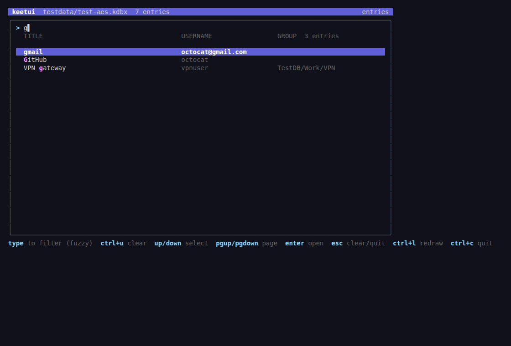

# keetui

A read-only terminal UI for KeePass databases (KDBX 3.1 and 4.x),
styled after `../vaultui`.



## Features

- Master password asked once, in a masked prompt at start; wrong
  password shows an error and lets you retry.
- A single `>` prompt at the top live-filters entries by title —
  substring matches first, then fuzzy matches (via
  [sahilm/fuzzy](https://github.com/sahilm/fuzzy)), best match first,
  with matched letters highlighted.
- The bottom pane lists matches (`TITLE  USERNAME  GROUP`); recycle
  bin entries are marked `[bin]`.
- `up`/`down` and `pgup`/`pgdown` scroll; `enter` opens the entry.
- In the entry view all fields are shown (title, username, password,
  URL, notes, expiry, tags, attachments); the password stays masked
  until `x` toggles visibility. There is no clipboard access — the
  tool is strictly read-only.
- Entry history is not duplicated into the list: only the live version
  of an entry is shown. Press `v` in the entry view to browse the
  entry's previous versions (newest first) and open any of them.
- `esc` clears the search (or quits when empty), `ctrl+u` erases the
  search, `ctrl+l` redraws, `ctrl+c` quits.

## Build & run

```sh
go build -o keetui .
./keetui path/to/database.kdbx
```

Requires Go 1.25+. Dependencies: bubbletea/bubbles/lipgloss (UI),
`golang.org/x/crypto` (blake2b/chacha20/salsa20 primitives),
`sahilm/fuzzy` (search). No KeePass library is used.

## Keys

| Key | Action |
|---|---|
| printable | extend the `>` filter query |
| `backspace` | edit query |
| `ctrl+u` | erase query |
| `esc` | clear query / quit |
| `up` `down` `pgup` `pgdown` | scroll the list |
| `enter` | open entry detail |
| `x` (in detail) | toggle password visibility |
| `v` (in detail) | browse entry history versions |
| `ctrl+l` | redraw |
| `ctrl+c` | quit |

## File format support

KDBX 3.1 and 4.0/4.1, AES-256 and ChaCha20 ciphers, AES-KDF and Argon2
(d/i) key derivation. The container is parsed by hand in
`internal/kdbx` (header, KDF, HMAC/hashed block stream, gzip, inner
header, XML, Salsa20/ChaCha20-protected values). Argon2 itself is
implemented from the spec in `internal/kdbx/argon2.go` on top of
x/crypto's blake2b, because x/crypto lacks Argon2d (the KDBX default).
Not supported: legacy KeePass 1.x `.kdb`, the Twofish cipher, key
files, and KDBX 2.x — all rejected with a clear error.

## Testing

```sh
go test ./...
```

Fixtures are synthetic KDBX files generated by `scripts/genfixture`
into `testdata/` (KDBX 3.1/AES-KDF, 4.0/AES-KDF, 4.1/Argon2id+ChaCha20;
password `test-password`). Argon2 is additionally validated against
the RFC 9106 test vectors and x/crypto. The parser was verified
against real KeePassXC-written files with output identical to
`keepassxc-cli`.

## Regenerating the screenshot

```sh
COLORTERM=truecolor script -qec "go run ./scripts/screenshot .shot.html" /dev/null
chromium --headless=new --disable-gpu --screenshot=screenshot.png \
  --window-size=1120,760 --hide-scrollbars file://$PWD/.shot.html
rm -f .shot.html
```

(`scripts/screenshot` drives the TUI against the fixture and renders
its ANSI view to HTML.)
